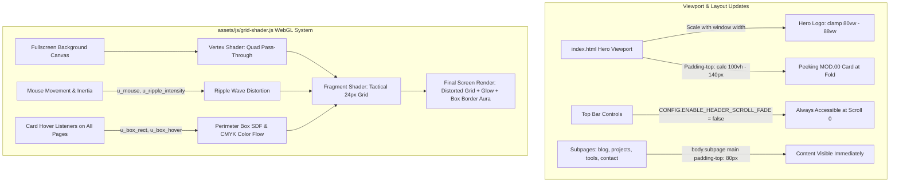

# Interactive Grid Shader & Site Layout Architecture Plan

## 1. Overview & Objectives

This plan addresses five interrelated frontend and visual enhancements across the KYZER site:
1. **Main Page Hero Typography & Responsive Width Scaling**: Make the hero brand text ("KYZER WEBER" / "KYZER") noticeably larger and proportional to window width across all breakpoints.
2. **Viewport Peeking Layout**: Adjust the main page layout so the introductory technical panel (`MOD.00 // INIT`, "Hi, Welcome, Hello.") peeks above the bottom fold of the screen (~15-18% visible), clearly signaling to users that content exists below.
3. **Top Bar Accessibility & Switchable Scroll Fade-in**: Retain the complete mechanism and CSS/JS code for the scroll-driven top bar fade-in, but disable it by default so the top bar, drawer toggle (`☰`), and colophon are fully accessible at scroll position zero without requiring user scrolling.
4. **Subpage Clean Layout (Eliminate 100vh Offset)**: Fix subpages (`/blog/`, `/projects/`, `/tools/`, `/contact/`) so their hero headers and cards render immediately at the top below the header rather than being pushed down 100vh into an empty screen.
5. **Interactive WebGL Fragment Shader Grid & Dynamic CMYK Box Glow**:
   - Create a WebGL fragment shader canvas running behind the content.
   - Implement an interactive grid ripple distortion where cursor movement dynamically bends the 24px tactical grid with smooth sinusoidal wave propagation and localized glow.
   - Implement dynamic fragment shader box hover glow across all pages (`index.html`, blog dispatches, project cards, tools nodes, contact cards): when hovered, an animated CMYK (cyan, magenta, yellow) color aura moves along the card border with soft fragment glow.

---

## 2. Mermaid Architecture Diagram



---

## 3. Detailed Component Specifications

### 3.1 Main Page Hero Typography & Peeking Fold

- **Files to modify**:
  - [`assets/js/home.js`](assets/js/home.js:105)
  - [`assets/css/components.css`](assets/css/components.css:188)
  - [`assets/css/home.css`](assets/css/home.css:1)

- **Responsive Hero Text Scaling**:
  - In [`assets/js/home.js`](assets/js/home.js:125), `startWidth` was previously capped at `680px`. On 1440px and 1920px screens, this resulted in an undersized hero presentation.
  - Update `startWidth` calculation to scale proportionally with window width:
    `const startWidth = Math.min(1280, Math.max(340, window.innerWidth * 0.86));`
  - Update `scale` to scale proportionally with window width:
    `const baseScale = Math.min(1.4, Math.max(0.9, (window.innerWidth * 0.95) / startWidth));`
  - Ensure the SVG logo text remains crisp and optically centered.

- **Viewport Peeking Layout**:
  - In [`assets/css/components.css`](assets/css/components.css:206), change `main` (for home page):
    ```css
    body:not(.subpage) main {
      padding-top: calc(100vh - 140px);
      padding-top: calc(100dvh - 140px);
    }
    ```
  - In [`assets/js/home.js`](assets/js/home.js:121), adjust initial vertical centering `startY`:
    `const peekHeight = 140;`
    `const startY = Math.max(60, (window.innerHeight - peekHeight) / 2);`
    This centers the hero typography in the visible portion of the viewport above the peeking panel.
  - In [`assets/js/home.js`](assets/js/home.js:110), update `getTargetSnapPoint()`:
    It automatically respects `heroSection.offsetTop - 70`, smoothly snapping the peeking panel into full frame when the user starts scrolling.

---

### 3.2 Top Bar Accessibility & Switchable Scroll Fade-In

- **Files to modify**:
  - [`assets/css/components.css`](assets/css/components.css:1)
  - [`assets/js/core.js`](assets/js/core.js:80)
  - [`assets/js/home.js`](assets/js/home.js:145)

- **Configuration & Toggle Architecture**:
  - Define a distinct configuration constant:
    `const ENABLE_HEADER_SCROLL_FADE = false;` (in [`assets/js/core.js`](assets/js/core.js) / [`assets/js/home.js`](assets/js/home.js))
  - In CSS [`assets/css/components.css`](assets/css/components.css:1), default `.title-bar`, `.nav-colophon-tag`, and `.tray-toggle` to fully accessible:
    - `.title-bar`: `background: var(--header-bg); backdrop-filter: blur(8px); border-bottom: 1px solid var(--panel-border);`
    - `.nav-colophon-tag`: `opacity: 1; pointer-events: auto;`
    - `.tray-toggle`: `opacity: 1; pointer-events: auto;`
  - Preserve the scroll-fade mechanism under a modifier class `body.enable-header-scroll-fade` or guarded by `ENABLE_HEADER_SCROLL_FADE`:
    If re-enabled in the future, setting `ENABLE_HEADER_SCROLL_FADE = true` or adding the class will smoothly fade the header in as before.
  - Allows instant access to the navigation drawer `☰`, theme toggle, and page links directly from the hero state.

---

### 3.3 Subpage Clean Layout (Eliminating 100vh Gap)

- **Files to modify**:
  - [`assets/css/components.css`](assets/css/components.css:455)
  - [`blog/index.html`](blog/index.html:196)
  - [`projects/index.html`](projects/index.html:254)
  - [`tools/index.html`](tools/index.html:240)
  - [`contact/index.html`](contact/index.html:324)

- **Layout Fixes**:
  - In [`assets/css/components.css`](assets/css/components.css:455):
    ```css
    body.subpage main,
    main.subpage-content {
      padding-top: 80px;
    }
    body.subpage .content-divider {
      display: none;
    }
    .subpage-hero {
      margin: 10px auto 30px auto;
    }
    ```
  - Subpages now load directly with their title cards (`MOD.01 // REPOSITORIES`, `MOD.02 // FIELD LOG`, `MOD.03 // COMMS ARRAY`, `MOD.04 // UTILITIES`) clearly in view below the header.

---

### 3.4 WebGL Fragment Shader Grid (Distortion Ripple & Mouse Glow)

- **New File**: [`assets/js/grid-shader.js`](assets/js/grid-shader.js)
- **Included In**: [`index.html`](index.html), [`blog/index.html`](blog/index.html), [`projects/index.html`](projects/index.html), [`tools/index.html`](tools/index.html), [`contact/index.html`](contact/index.html) (or initialized via [`assets/js/core.js`](assets/js/core.js))

- **Canvas & WebGL Context**:
  - Fullscreen `<canvas id="gridCanvas" class="grid-canvas"></canvas>`.
  - Fixed background: `position: fixed; inset: 0; width: 100vw; height: 100vh; pointer-events: none; z-index: 0;`.
  - Content containers retain `z-index: 1; position: relative;` for crisp foreground interaction.
  - Device pixel ratio capped at 2.0 for buttery 60fps performance without unnecessary GPU load.

- **Uniforms**:
  - `u_resolution`: `vec2` (canvas pixel size)
  - `u_mouse`: `vec2` (current cursor position, smoothly interpolated via spring physics)
  - `u_time`: `float` (elapsed seconds)
  - `u_ripple_intensity`: `float` (amplified by cursor velocity, decays when stationary)
  - `u_grid_color`: `vec3` (dynamic RGB for dark mode vs light mode)
  - `u_glow_color`: `vec3` (cyan `#00FFFF` in dark mode, deeper teal in light mode)
  - `u_grid_alpha`: `float` (base grid line opacity)
  - `u_cell_size`: `float` (24.0 pixels, strictly matching the site's 24px baseline)

- **Fragment Shader Wave & Ripple Physics**:
  - Calculates distance `d` from pixel to mouse coordinate.
  - Displaces grid sampling coordinates along radial vector `normalize(coord - mousePos)` using a damped sine wave:
    `float wave = sin(d * 0.045 - u_time * 4.5) * exp(-d * 0.0075) * u_ripple_intensity;`
  - Samples distorted coordinates to draw tactical 1px lines at 24px intervals with anti-aliasing.
  - Adds soft radial glow surrounding the cursor and illuminated ripple crests.

---

### 3.5 Fragment Shader Box Hover Glow & Moving CMYK Border Aura

- **User Requirement**:
  Dynamic glow effect around boxes on all pages when hovered, implemented via fragment shader so the glow effect moves and changes colors with the border.

- **Box Hover Shader Pipeline**:
  - Additional Fragment Shader Uniforms:
    - `u_box_rect`: `vec4` (x, y, width, height) of currently hovered card in screen coordinates.
    - `u_box_hover`: `float` (smooth transition 0.0 -> 1.0 on hover).
  - Signed Distance Field (SDF) of rectangle:
    ```glsl
    vec2 boxCenter = u_box_rect.xy + u_box_rect.zw * 0.5;
    vec2 boxHalf = u_box_rect.zw * 0.5;
    vec2 dBox = abs(coord - boxCenter) - boxHalf;
    float dist = length(max(dBox, 0.0)) + min(max(dBox.x, dBox.y), 0.0);
    ```
  - Traveling CMYK Color Along Perimeter:
    - Perimeter parameter calculated from angle around center:
      `float perimeter = atan(coord.y - boxCenter.y, coord.x - boxCenter.x);`
      `float phase = mod(perimeter / 6.2831853 - u_time * 0.4, 1.0);`
    - Color cycle interpolation:
      `0.0 -> Cyan (#00FFFF)`
      `0.33 -> Magenta (#FF00FF)`
      `0.66 -> Yellow (#FFFF00)`
      `1.0 -> Cyan (#00FFFF)`
  - Dual-Layer Aura:
    - **Outer Glow**: `float outerGlow = exp(-max(0.0, dist) * 0.07) * u_box_hover * 0.8;`
    - **Border Stroke**: `float borderStroke = smoothstep(2.5, 0.0, abs(dist)) * u_box_hover;`
    - Combined with mouse proximity highlight that flares where the cursor is closest to the border.
  - Unified Event Listener across all pages:
    - Listens to `mouseenter` and `mouseleave` across `.tech-panel, .glow-container, .column-panel, .dispatch-card, .repo-card, .tool-node-card, .contact-card`.
    - Updates `u_box_rect` with `element.getBoundingClientRect()` and smoothly animates `u_box_hover`.

---

## 4. Implementation Checklist

- [ ] 1. Create [`assets/js/grid-shader.js`](assets/js/grid-shader.js) implementing WebGL canvas creation, ripple distortion shader, and box hover CMYK border aura.
- [ ] 2. Update [`assets/css/theme.css`](assets/css/theme.css) and [`assets/css/components.css`](assets/css/components.css) to add canvas styles and fallback gracefully.
- [ ] 3. Update [`assets/css/components.css`](assets/css/components.css) to fix subpage `padding-top: 80px` and enable peeking fold on main page.
- [ ] 4. Update [`assets/js/home.js`](assets/js/home.js) with responsive `startWidth`, peeking `startY`, and disabled top-bar scroll fade flag.
- [ ] 5. Update [`assets/js/core.js`](assets/js/core.js) to initialize shader across all pages and wire card hover bounds.
- [ ] 6. Include [`assets/js/grid-shader.js`](assets/js/grid-shader.js) in [`index.html`](index.html), [`blog/index.html`](blog/index.html), [`projects/index.html`](projects/index.html), [`tools/index.html`](tools/index.html), and [`contact/index.html`](contact/index.html).
- [ ] 7. Verify responsive typography scaling, peeking content fold, immediate top bar access, subpage top alignment, and 60fps WebGL grid ripple & box aura animations.
